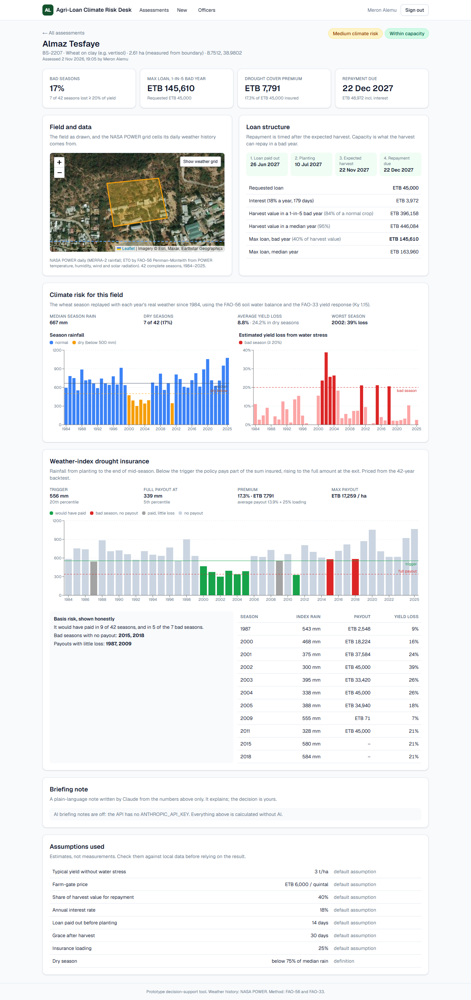
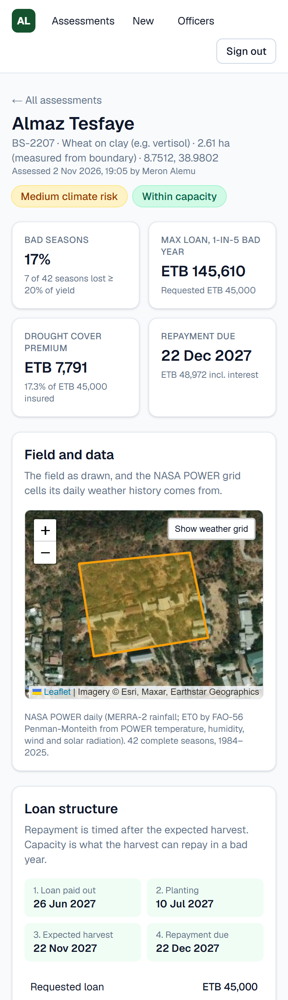
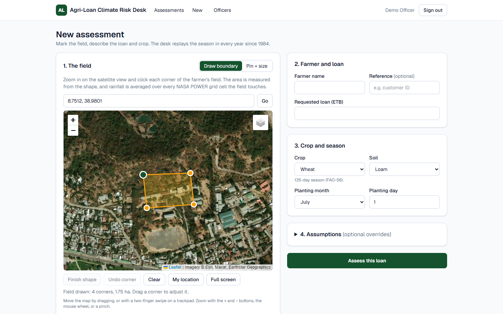
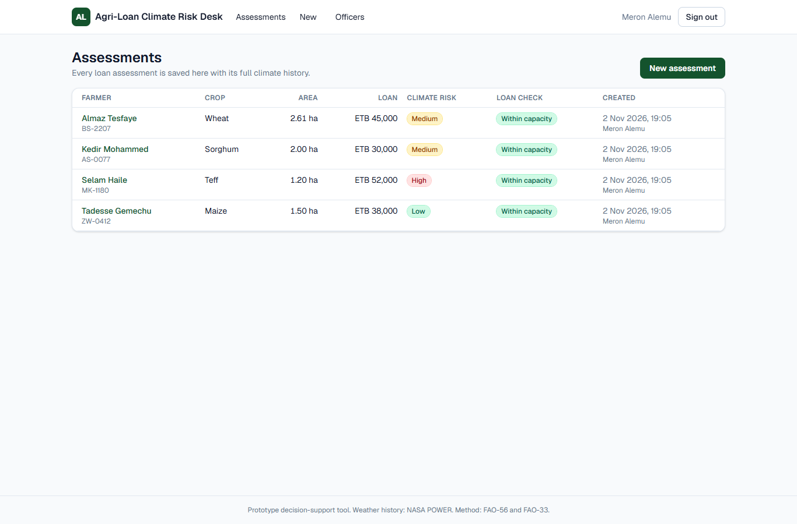
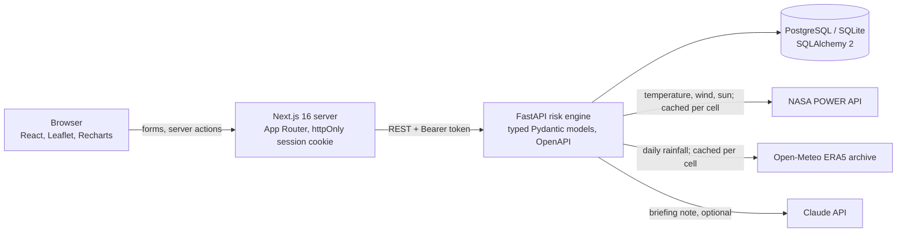

# Agri-Loan Climate Risk Desk

A full-stack tool for **agricultural loan officers**. The officer draws a smallholder farmer's field on a satellite map and enters the crop, planting date and requested loan. The desk then replays that crop season in every year since 1984, using the real daily weather for that exact field, and returns three things:

1. **Climate risk for the field:** season rainfall for every year, how often the season was dry, and the yield lost to water stress in each year.
2. **A loan structure that fits the farm:** repayment dates after the expected harvest, and the largest loan the harvest could still repay in a 1-in-5 bad year.
3. **A priced drought insurance option:** a weather-index policy (trigger, exit, premium) designed and back-tested on the same 42 seasons. It shows the years it would have paid, and also the bad years it would have missed.

An AI briefing note (Claude) can then explain the result to the officer in English or Amharic, using only the computed numbers.

It is built with **Next.js (React) + FastAPI (Python) + PostgreSQL/SQLite**, with sign-in for loan officers, saved assessment history, GIS field boundaries, Docker, and CI. It is a working prototype, not a credit model trained on repayment data (see [Limitations](#limitations)).

## Try it live

**[agri-loan-desk.vercel.app](https://agri-loan-desk.vercel.app)**: press **Try the demo** on the sign-in page. The demo account has every feature and is walled off from real accounts. API docs: [agri-loan-desk-api.onrender.com/docs](https://agri-loan-desk-api.onrender.com/docs). The API runs on a free plan, so the very first request after a quiet spell can take about a minute.

<p>
  
  
</p>
<p>
  
  
</p>

---

## Run it yourself (Docker)

```bash
cp .env.example .env     # fill in SECRET_KEY, ADMIN_EMAIL, ADMIN_PASSWORD, POSTGRES_PASSWORD
docker compose up --build
```

Then open port 3000 for the desk (sign in with `ADMIN_EMAIL` / `ADMIN_PASSWORD`) and port 8000 `/docs` for the API docs.

Compose runs three Linux containers: **PostgreSQL 17**, the **FastAPI** risk engine and the **Next.js** server. The first admin account is created from the environment on first start; add loan officers from the **Officers** page.

## Local run (no Docker)

```bash
# API: Python 3.13, SQLite by default
cd api
python -m venv .venv
.venv\Scripts\activate                 # macOS/Linux: source .venv/bin/activate
pip install -r requirements-dev.txt
copy ..\.env.example .env              # macOS/Linux: cp ../.env.example .env, then fill it in
uvicorn app.main:app --port 8000

# Web: Node 24, in a second terminal
cd web
npm install
npm run dev                            # port 3000; API_URL defaults to the API on port 8000
```

The weather data (ERA5 through Open-Meteo, and NASA POWER) is free and needs no key. `ANTHROPIC_API_KEY` is optional: without it everything works except the AI briefing note, and the page says why.

---

## What the officer sees

- **Field and data:** the field on satellite imagery, plus the weather grid cells its history came from.
- **Headline numbers:** share of bad seasons, maximum loan in a 1 in 5 bad year against the amount requested, drought cover premium, repayment date.
- **Loan structure:** a timeline (loan paid out, planting, expected harvest, repayment due), interest, harvest value in a bad and a median year, and a verdict: *Within capacity*, *Repayable in a normal year only* or *Above capacity*.
- **Climate risk:** charts of season rainfall and estimated yield loss (water and heat) for every season since 1984, with dry seasons and bad seasons marked, plus a trend check: is rainfall or yield loss changing, and are recent seasons worse than earlier ones?
- **Drought insurance:** trigger and exit in mm, premium, maximum payout per hectare, a back-test chart, and a **basis risk** panel. It lists bad seasons the index would not have paid for, and payouts in years with little loss.
- **AI briefing note:** Claude explains the case in English or Amharic. It is told not to approve or reject the loan, and to separate measured history from assumptions.
- **Assumptions used:** every assumption behind the money figures, labelled as an assumption or as an officer override.
- **History:** every assessment is saved with its full result. Officers see their own; admins see all.

---

## How the risk is calculated

The engine is in [`api/app/risk/`](api/app/risk). Every agronomic value carries the number of the FAO table it comes from.

**1. Weather history (ERA5 rainfall + NASA POWER).** Daily **rainfall** comes from the ECMWF **ERA5** reanalysis through the free [Open-Meteo archive](https://open-meteo.com/en/docs/historical-weather-api), on a 0.25° grid (about 28 km). Each ERA5 cell covers about a fifth of the area of a NASA POWER cell, so local dry spells are smoothed less. Daily **temperature, humidity, wind and solar radiation** come from the [NASA POWER](https://power.larc.nasa.gov/) API on its 0.5° × 0.625° grid; if the drawn field touches more than one POWER cell, they are averaged. The history runs from 1984 (POWER's solar radiation starts mid-1983) to the last complete year: 42 seasons. Every grid cell is downloaded once and cached in the database. If ERA5 cannot be reached, the desk falls back to POWER rainfall (`PRECTOTCORR`, MERRA-2) and says so on the result.

> CHIRPS (0.05°) would be finer still. It needs bulk raster downloads rather than a point API, so it remains a next step under [Limitations](#limitations).

**2. Reference evapotranspiration.** ET₀ is computed for every day with the **FAO-56 Penman-Monteith** equation ([`et0.py`](api/app/risk/et0.py)), and is tested against FAO-56 Example 18.

**3. The season, replayed for each year** ([`season.py`](api/app/risk/season.py)):
- The crop coefficient Kc and rooting depth follow the FAO-56 crop curve from the planting date (Tables 11, 12, 22).
- A daily root-zone **water balance** (FAO-56 eq. 85) with effective rain. The crop is stressed (Ks < 1, eq. 84) once it has used its readily available water.
- 30 days of bare-soil spin-up before planting, so each year starts from that year's rains.
- **Yield loss from water stress** uses the FAO-33 yield response: `1 − Ya/Ym = Ky × (1 − ETa/ETm)`.
- **Heat around flowering.** In the first 20 days of mid-season, every degree-day of daily maximum temperature above the crop's critical value (wheat and barley 34 °C, teff and maize 35 °C, sorghum 38 °C) takes 1% off the water-limited yield.

**4. Risk summary.** A *dry season* has rainfall below 75% of the median. A *bad season* loses at least 20% of its yield. The climate risk rating is Low (under 10% bad seasons), Medium (under 25%) or High.

**Trend check** ([`trend.py`](api/app/risk/trend.py)). The Theil–Sen slope of season rainfall and of yield loss (per decade), tested with Mann–Kendall at the 10% level, and the share of bad seasons in the last 15 seasons against the ones before. It is shown next to the risk figures as a warning; it does not change them.

**5. Loan structure** ([`engine.py`](api/app/risk/engine.py)):
- **Dates.** The loan is paid out 14 days before the next planting date and falls due 30 days after the expected harvest. Harvest is planting plus the FAO-56 season length.
- **Harvest value in a bad year.** Area × typical yield × the 20th percentile relative yield from the history × price.
- **Maximum loan.** The share of the harvest value set aside for repayment, divided by (1 + interest for the loan's term).

**6. Weather-index insurance** ([`insurance.py`](api/app/risk/insurance.py)):
- **Index.** Rainfall from planting to the end of mid-season, the water-sensitive part of the season.
- **Trigger and exit.** The 20th and 5th percentiles of the historical index. Officers can change both.
- **Payout.** Rises in a straight line from 0 at the trigger to the full sum insured at the exit. The sum insured is the loan amount.
- **Premium.** The average payout over all 42 years (the "burning cost") plus a 25% loading.
- **Basis risk is reported both ways.** Bad seasons with no payout, and payouts with little loss.

**7. AI briefing note** ([`summary.py`](api/app/summary.py)). The saved result is sent to `claude-opus-5-5` through the Anthropic Python SDK. The instructions say to use only the numbers given, never to decide the loan, and to name the assumptions that matter. If the model declines, the API retries on Anthropic's recommended fallback model. If it still declines, the page says so.

### Assumptions (not facts)

All money assumptions sit in one file, [`api/app/risk/assumptions.py`](api/app/risk/assumptions.py), and every result page lists the ones it used:

| Assumption | Default | Note |
|---|---|---|
| Typical yield (t/ha) | wheat 3.0, teff 1.9, maize 4.2, sorghum 2.9, barley 2.5 | Rounded from CSA national averages; officers can override per assessment |
| Farm-gate price (ETB/quintal) | wheat 6,000, teff 12,000, maize 4,000, sorghum 5,000, barley 6,000 | Placeholders; officers should enter the current local price |
| Share of harvest value for repayment | 40% | |
| Interest rate | 18% a year, flat | |
| Disbursement / grace | 14 days before planting / 30 days after harvest | |
| Insurance loading | 25% | |
| Heat loss | 1% of yield per degree-day above the critical temperature, first 20 days of mid-season | Critical temperatures are approximate values from heat-stress studies, not FAO tables |

Teff and barley have no seasonal Ky in FAO-33, so Ky = 1.0 is assumed. Teff uses small-grain FAO-56 values. Both are shown as notes in the app.

---

## Architecture



- **The browser never calls the API directly.** Pages and server actions call it from the Next.js server, with the officer's token kept in an httpOnly cookie.
- **FastAPI** owns everything else: sign-in, roles, validation, the risk engine and the database. Passwords are scrypt hashes. Session tokens are HMAC-signed and stop working when the password changes. Five failed sign-ins lock the account for 10 minutes.
- **Typed models.** Every request and response is a typed Pydantic model, so the OpenAPI docs at `/docs` are complete.
- **GIS.** The field boundary is stored as a GeoJSON Polygon. Its area is calculated on the server with a geodesic (spherical-excess) formula; the browser shows the same calculation live while drawing.
- **Databases.** Docker Compose uses PostgreSQL. Local runs and tests use SQLite unless `DATABASE_URL` / `TEST_DATABASE_URL` say otherwise.

| Path | What it does |
|---|---|
| `api/app/risk/` | Pure-Python risk engine: crops, ET₀, season simulation, insurance, loan, geometry |
| `api/app/main.py` | FastAPI routes: auth, users, reference data, assessments, AI note, health |
| `api/app/db.py` | SQLAlchemy models: users, assessments (with GeoJSON), climate cache |
| `web/app/` | Next.js pages: sign-in, assessment list, new assessment, results, officers |
| `web/components/` | Field drawing map, result map, charts |
| `web/e2e/` | Playwright end-to-end tests |
| `.github/workflows/ci.yml` | CI: API tests on SQLite and PostgreSQL, web lint, build and end-to-end tests, Docker image build |

---

## Tests

```bash
cd api && python -m pytest          # risk maths, climate client, geometry, API, AI note (no network)
cd web && npm run build && npm run test:e2e   # starts the API and web app; needs internet for NASA POWER
```

- **API tests (pytest), 62 in total:**
  - FAO-56 worked examples: saturation vapour pressure, Example 8 (Ra), Example 18 (daily ET₀).
  - Water balance and FAO-33 yield response.
  - Percentile, payout and premium maths, and basis-risk flags.
  - Loan dates and capacity, and polygon area.
  - The NASA POWER client against faked responses and failures.
  - The AI note with a faked client.
  - The HTTP API: sign-in, lockout, roles, validation, officer isolation, and password change signing out old sessions.
- **End-to-end tests (Playwright), 5 in total:**
  - Pages are blocked until you sign in, and a wrong password is refused.
  - **Draw a real field near Bishoftu, assess it against live NASA POWER data,** and find it in the history.
  - An admin adds an officer, who sees only their own assessments.
  - The results page has no sideways scroll on a phone.
- **CI** runs the API tests on SQLite and on a PostgreSQL service, then lint, build and the end-to-end tests, and builds both Docker images on Linux.

---

## Deploy (free tiers)

| Part | Host | Notes |
|---|---|---|
| Database | **Neon** or **Supabase** (PostgreSQL) | Neon: free with no expiry, copy the connection string. Supabase: use the **Session pooler** string (port 5432, IPv4) |
| Risk API | **Render** (Docker, from `render.yaml`) | Free plan sleeps after 15 minutes idle |
| Web app | **Vercel** (Next.js) | Root directory `web` |

1. **Database:** on **Neon**, create a project (region near the API, e.g. Frankfurt) and copy the connection string from *Connect*. Or on **Supabase**, *Connect → Session pooler* and copy the URI, replacing `[YOUR-PASSWORD]`. The app accepts either address as shown (`postgresql://…`, including `?sslmode=require`); tables are created on first start.
2. **Render:** *New → Blueprint*, pick this repository. Render reads `render.yaml`, generates `SECRET_KEY`, and asks for `DATABASE_URL`, `ADMIN_EMAIL`, `ADMIN_PASSWORD` and the optional `ANTHROPIC_API_KEY`. It also sets `DEMO_ACCOUNT=true`, which adds a **Try the demo** button to the login page. The demo account has no password, sees the admin pages, and is walled off: it sees only its own assessments, cannot see or add other accounts, and cannot change anything that already exists. Remove the variable to turn it off. When it is live, open `https://<service>.onrender.com/health`.
3. **Vercel:** *Add New → Project*, import this repository, set **Root Directory** to `web`, and add the environment variable `API_URL` = the Render address (no trailing slash). Deploy.
4. **Keep the API awake (optional):** in GitHub, *Settings → Secrets and variables → Actions → Variables*, add `API_HEALTH_URL` = `https://<service>.onrender.com/health`. The `keep-warm` workflow then pings it every 14 minutes.

The browser never calls the API: Next.js server code calls it with `API_URL`, so no CORS setup is needed.

---

## Limitations

- **No repayment data.** The desk estimates *climate* risk from weather and an agronomic model. It does not know the farmer's credit history, other income or management, and the money figures depend on the assumptions above. It supports an officer's judgement; it does not replace a credit model.
- **Rainfall is still a grid average.** Rainfall now comes from ERA5 (about 28 km, five times finer in area than the NASA POWER grid used before), but it is still a reanalysis average. CHIRPS (about 5 km) or local station records would sharpen field-level risk further.
- **Simplified agronomy.** A single-layer bucket model with fixed soil and crop values, no fertility or pests, and an assumed soil state before planting. Heat stress is a simple degree-day rule around flowering, driven by NASA POWER temperature on a coarse (about 55 km) grid, so it can miss hot spells in lowland fields. Teff and barley Ky values and all heat thresholds are assumptions.
- **Insurance design is illustrative.** Linear payout on one cumulative rainfall index, priced on burning cost. A real product would use dekadal (10-day) phases, a reinsurer's loading and regulatory approval.
- **Trends are flagged, not projected.** The desk tests whether rainfall and yield loss are trending and compares recent seasons with earlier ones, but the risk rating, loan capacity and premium still weigh all 42 seasons equally. Forty-two seasons is a short record for spotting a trend, and no climate projection is used.
